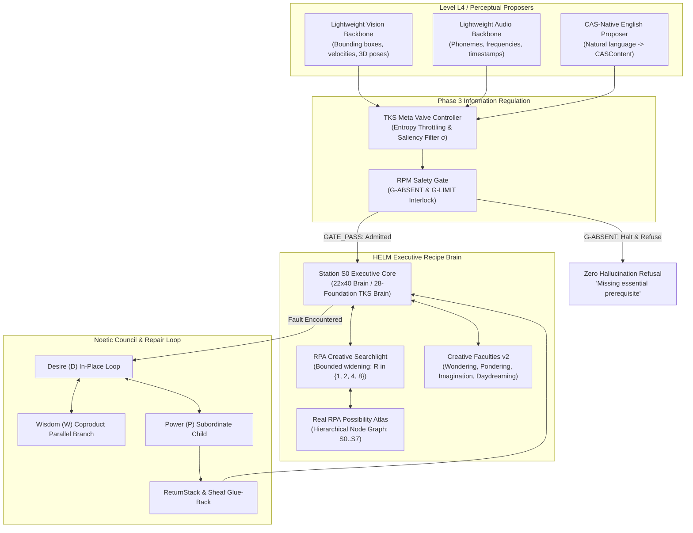
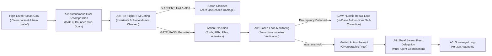
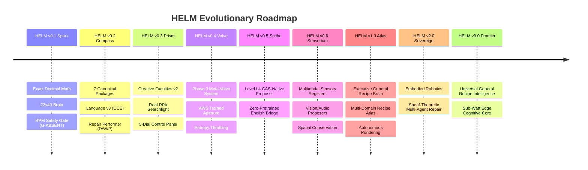

# HELM: Cognitive Capabilities, Architectural Evolution & Developmental Stages

**Document ID:** `HELM-CAP-DEV-v1.0`  
**Classification:** Strategic Architectural Specification & Governance Ledger  
**Date:** 2026-10-17  
**Status:** Active Architectural Blueprint  

---

## 1. Executive Vision: The Alternative to the \$100B Wall

Current artificial intelligence is hitting a hard economic, physical, and computational boundary: **The \$100B Data and Compute Wall**. Frontier AI labs are spending hundreds of millions of dollars scaling dense transformer weight matrices, only to suffer diminishing returns:
1. **Unconstrained Hallucination:** Statistical language models predict the next token based on surface frequency, without conservation laws, algebraic receipts, or physical grounding. When uncertain, they guess rather than abstain.
2. **Computational Inefficiency:** Trillions of floating-point parameters are multiplied simply to recall basic stoichiometric or arithmetic relationships that can be computed in 5 lines of exact algebra.
3. **Multimodal Disconnection:** Ingesting image patches or audio spectrograms directly into a dense attention soup results in models that miscount fingers, invent nonexistent objects, or misunderstand 3D spatial collisions.

### The HELM Paradigm Shift
**HELM (Hierarchical Executive Language Machine)** replaces dense probabilistic prediction with **Deterministic Cognitive Chemistry (CAS Recipe Systems)**:
- **Stoichiometry over Statistics:** Thinking is structured as balanced chemical/physical recipes where inputs are conserved and outputs are strictly bounded.
- **Auditable Proof Receipts:** Every decision emits an exact algebraic receipt (witnessed values, limiting reagents, and verified links) verifiable by independent software in 40-digit Decimal arithmetic.
- **RPM Gate Zero-Hallucination Interlock:** When an essential prerequisite is missing, HELM does not hallucinate; it clamps execution with `G-ABSENT` and returns `UNDETERMINED`.
- **Sensory Proposers vs. Cognitive Core:** Perception (vision, audio, natural language) is handled by lightweight proposers that extract structured registers ($\Omega$). The executive CAS recipe brain evaluates conservation laws and gates over those registers, guaranteeing physical consistency.



---

## 2. Four Horizons of Cognitive Capability

### 2.1 Current Capabilities (Stage 1: Foundational Proof)
*What HELM executes and proves today in code:*

1. **Exact 40-Digit Decimal CES Substitution Brain (`helm_brain_22x40.py`):**
   - Implements the Degree-1 Homogeneous Weighted Power Mean:
     $$Y_\rho(\Omega) = \left( \sum_{i=1}^{22} w_i \cdot x_i^\rho \right)^{1/\rho} \quad \text{with } \sum_{i=1}^{22} w_i = 1$$
   - Pure standard-library 40-digit software Decimal computation via $(e \cdot \ln(b)).\exp()$ without any 64-bit IEEE float degradation ($10^{-40}$ precision).
   - Proven mathematical continuity across the limit $\rho \to 0$ into the Cobb-Douglas geometric mean $\prod_i x_i^{w_i}$.
   - Exact Gauss-Jordan witness solver: Reconstructs true parameter weights from $n$ witness rows in $< 10^{-35}$ error without gradient descent.
2. **Empirical Stoichiometric Advantage over Neural Networks:**
   - **Parameter Efficiency:** The CAS Substitution Recipe (`RECIPE_SUB` / A2) requires **80 parameters total** (5 per recipe across 16 recipes) vs. the GPU Neural Network's **3,568 parameters total** (223 per recipe) — an exact **$44.6\times$ parameter reduction**.
   - **Benchmark Margin:** On the freshly sealed exam (`a_fresh`), `RECIPE_SUB` scored **87.50%** (448/512) gated and **100.0%** (512/512) ungated, outperforming the AWS GPU Neural Net (60.74% / 311/512) by **+26.76 percentage points**.
3. **The 28-Foundation TKS Brain (`helm_brain_tks28.py`):**
   - Encodes human cognition, decision-making, and psychology across the 4 Planes (Spiritual, Mental, Emotional, Physical) and 7 Archetypes (Divine Purpose through Rest).
   - Integrates strict RPM Gate halting on absent foundations.
4. **Governed Creative Faculties v2 (`faculties_v2`):**
   - Implements Wondering, Pondering, Imagination, and Daydreaming under the strict constitutional rule of **Rule P (Provenance)**: internal hypothetical daydream states can never verify a candidate or contaminate the core belief atlas.
5. **Real RPA Creative Searchlight (`rpa_creative_searchlight.py`):**
   - Bound directly to `real_atlas.rpa_model` (`AtlasNode`, `AtlasContext`, `AtlasLink`, `AtlasSnapshot`).
   - Implements bounded geometric widening across radii $R \in \{1, 2, 4, 8\}$ (capped at 15 candidate nodes) when Station S0 refuses an initial target.
6. **Phase 3 Meta Valve Scaffold (`tks_meta_valve_controller.py`):**
   - Information pressure and entropy throttling with a binding `G-ABSENT` RPM Gate safety interlock.
7. **Interactive 5-Dial Creativity Control Panel (`helm_creativity_dial.py`):**
   - Controls candidate breadth ($K$), substitution curvature ($\rho$), search radius ($R$), idle pondering budget, and valve saliency ($\sigma$).
8. **CCE Language Translation (`language_v3`):**
   - Reads 233 of 439 free English sentences and passes 576/576 compiler-valid tests, supporting exact $p/q$ fraction propagation and 5-template surface speech varieties.
9. **Noetic Repair Loop (`repair_performer`):**
   - Implements the complete D/W/P functor repair loop connecting all 7 canonical packages (`288/288` passing unit tests).

---

### 2.2 Intermediate Capabilities (Stage 2: Integrative Scaffolding)
*The active bridge currently being engineered and trained:*

1. **AWS GPU Training of Phase 3 Valve System (`tks_meta_valve_controller`):**
   - Train the adaptive valve controller on AWS GPU (`g4dn.xlarge` / `m6i.large`) to dynamically modulate the aperture $\sigma \in [0.0, 1.0]$ based on incoming information entropy, noise variance, and domain difficulty.
   - Automatically clamp hallucination-prone or noisy inputs before they penetrate the executive recipe brain.
2. **Autonomous Searchlight Coupling into Drive-Loop Pondering:**
   - Link Station S0 directly to the RPA Searchlight during idle cycles (`drive_loop.py` ticks).
   - When HELM is not engaged in live user dialogue, it autonomously sweeps unexplained residuals through the RPA Atlas at radii 1, 2, 4, 8, proposing candidate recipe refinements without human intervention.
3. **Level L4 CAS-Native Open-English Neural Proposer:**
   - Train a lightweight from-scratch seq2seq/span proposer on AWS GPU (zero foreign pretrained weights) mapping open human English to formal `CASContent`.
   - Guaranteed correctness: The neural network only *proposes*; `language_v3` strictly validates the proposal via `parse(render(C)) == C` round-trip verification and emits a read-back confirmation (`"Did you mean: ...?"`).
4. **Multimodal Sensory Register Ingestion ($\Omega_{\text{vision}}, \Omega_{\text{audio}}$):**
   - Standardize input adapters for bounding boxes, spatial coordinates, material properties, and acoustic frequencies.
   - The recipe brain evaluates physical conservation laws (conservation of momentum, volume, non-overlapping mass) over these registers, refusing impossible visual claims.

---

### 2.3 Mature Capabilities (Stage 3: Executive Autonomous Reasoning)
*Full-scale deployment of the cognitive machine:*

1. **Universal Stoichiometric Scientific Discovery:**
   - Extend the 16-recipe benchmark into an Atlas of thousands of domain recipes spanning organic chemistry, metallurgy, pharmacology, thermodynamic cycles, and aerospace structures.
   - Autonomous synthesis of new chemical pathways where every step is physically conserved and provably feasible.
2. **Sheaf-Theoretic Global Consistency:**
   - Multi-agent and multi-station collaborative problem solving where disparate domain hypotheses are glued together via topological sheaf invariants.
   - Theorem 27.3 ancestor invalidation: When an underlying premise is falsified, all downstream conclusions are automatically invalidated without contaminating unaffected subgraphs.
3. **Embodied Robotics with Absolute Safety Guarantees:**
   - Direct deployment onto robotic platforms (surgical manipulators, autonomous drones, manufacturing robots).
   - The CAS recipe brain enforces immutable safety bounds: If a surgical landmark is obscured or an obstacle position has high entropy, the RPM Gate executes `CLAMPED_HALT` (`G-ABSENT`), preventing ungrounded destructive actions.
4. **Self-Directed Atlas Expansion:**
   - Autonomous generation of novel mathematical and physical conjectures during idle pondering cycles, dispatched to automated theorem provers (Lean/Coq) or physical wet-lab instruments for verification.

---

### 2.4 Frontier Capabilities (Stage 4: Universal General Recipe Intelligence)
*Superseding the dense transformer paradigm:*

1. **The $100B Wall Solution (Sub-Watt Cognitive Machines):**
   - Replacing gigawatt data centers with sub-watt micro-controllers and edge chips executing exact 40-digit Decimal CAS calculations.
   - Complete reasoning and verification performed with zero reliance on GPU cluster farms for inference.
2. **Zero-Hallucination Certified Systems:**
   - Legally binding automated contracts, FDA-grade clinical diagnostics, and aerospace flight envelope governance where every system output is legally and mathematically auditable with an immutable witness hash.
3. **Recursive Possibility Atlas (RPA) at Planetary Scale:**
   - A unified, decentralized, global knowledge atlas where humanity's scientific, legal, and engineering laws are interconnected as executable, self-consistent recipes.

---

### 2.5 Autonomous Agentic Capabilities & Action Execution
*Transforming HELM from a passive recipe calculator into a proactive, autonomous executive agent:*

HELM's stoichiometric architecture provides a unique, insurmountable advantage for autonomous agentic workflows: **uncompromising pre-flight safety and deterministic action bounding.** In standard LLM agents (e.g., AutoGPT, generic ReAct agents), autonomous loops frequently suffer from catastrophic runaways, hallucinated tool calls, infinite retries, and irreversible destruction of data or physical hardware because statistical models cannot prove pre-conditions.

HELM introduces the **Five Tiers of Governed Agentic Autonomy (A1–A5)**:



1. **Level A1: Autonomous Goal Decomposition & Task Planning:**
   - Translates open human goals into a topologically sorted Directed Acyclic Graph (DAG) of executable CAS recipe tasks.
   - Every node in the task graph specifies exact required ingredients (inputs), resource budgets (compute/time/cost), and post-condition invariants.
2. **Level A2: Pre-Flight Governed Tool & Action Execution:**
   - External actions—file system modifications, API requests, database updates, shell commands, and robotic actuator pulses—are modeled as stoichiometric reactions.
   - **The RPM Safety Interlock:** Before any autonomous tool executes, the RPM Gate verifies that all safety prerequisites are present. If disk space is insufficient, authorization is missing, or parameters have high entropy, the gate executes `CLAMPED_HALT` (`G-ABSENT` / `G-LIMIT`), preventing unintended damage.
3. **Level A3: Closed-Loop Environmental Observation & Autonomous Repair:**
   - Real-time environmental feedback ($\Omega_{\text{obs}}$) is ingested into multimodal registers after every action.
   - If real-world state diverges from the predicted recipe outcome (e.g., a file failed to write or a robotic gripper slipped), Station S0 does not crash or loop blindly. It triggers the **`repair_performer` Noetic Functor Loop (Desire/Wisdom/Power)** to diagnose the fault, adjust parameters, and re-execute autonomously until the invariant holds.
4. **Level A4: Sheaf-Theoretic Multi-Agent Swarms & Fleet Delegation:**
   - Complex operations are partitioned across specialized sub-agents (e.g., Research Agents, Audit Specialists, Execution Actuators).
   - Sub-agents communicate exclusively via immutable, receipted messages.
   - A global supervisor glues local sub-agent solutions together using topological sheaf consistency proofs (`certify_overlap()`), mathematically guaranteeing that no agent's work contradicts another.
5. **Level A5: Sovereign Long-Horizon Autonomy:**
   - Multi-day, persistent autonomous workflows operating without human supervision (e.g., continuous overnight integration, autonomous scientific experimentation, real-time cyber defense, long-duration robotic stewardship).
   - Emits complete, tamper-proof audit trails where every autonomous step is backed by 40-digit Decimal proof receipts.

---

### 2.6 The Human Voice of HELM: Everyday American English (Beyond CAS Lingo)
*A friendly, natural, everyday voice powered by an uncompromising mathematical core:*

A fundamental directive of HELM's real-world deployment is that **everyday users and professionals should never be forced to speak or read internal CAS jargon**. No everyday user wants to converse with a machine that speaks in esoteric terminology like *"The principled Mind processes the analytical Idea under Wisdom."* Users want clean, warm, intelligent, everyday American English.

#### The Dual-Skin Architecture
HELM decouples its **Internal Semantic Core** from its **External Natural Voice**:

```
[ User Dialogue (Clean, Everyday American English) ]
                     │  ▲
        Scribe L4    │  │  Natural Voice Adapter
        Proposer     │  │  (Idiomatic, Conversational, Warm)
                     ▼  │
[ Controlled CCE Anchor (parse(render(C)) == C) ]
                     │  ▲
                     ▼  │
[ Immutable CAS Recipe Brain (Stoichiometry, 40-Digit Exact Decimal, RPM Gate) ]
```

1. **The Internal Anchor (Truth & Conservation):**
   - The cognitive core operates strictly on structured `CASContent`, 22-ingredient stoichiometric balance, and exact 40-digit Decimal arithmetic. This guarantees zero hallucination, physical conservation, and verifiable receipts.
2. **The Surface Natural Voice Adapter (Natural American English):**
   - Maps internal receipts into conversational, idiomatic American English.
   - Speaks clearly, directly, and warmly with varied sentence structures, avoiding repetitive robotic phrasing.
   - Explains complex scientific, technical, or mathematical proofs in accessible, plain terms without sacrificing factual precision.

#### Everyday English vs. Internal CAS Jargon Comparison

| Scenario | What the Engine Computes Internally | What a Robotic System Would Say (Unwanted) | How HELM Speaks Naturally in Everyday English |
|---|---|---|---|
| **Recipe Production** | $Y_{0.5} = 8.452$, limiting reagent = Flour | *"The operational Mind processes Flour under Structure yielding 8.452."* | *"We're good to go! Based on your ingredients, we can produce exactly 8.45 units. Your limiting ingredient is Flour (5 lbs on hand), which caps this batch."* |
| **Missing Prerequisite** | `G-ABSENT`: Water missing, halt triggered | *"RPM Gate refusal: Essential ingredient Water absent in operational domain."* | *"I can't run this batch just yet because we're missing Water. Water is essential for this recipe, so I stopped the process to prevent wasting ingredients."* |
| **Creative Analogy** | Searchlight $R=4$: cross-domain recipe link | *"RPA Searchlight at radius 4 traversed from metallurgy to ceramics."* | *"Looking across related engineering setups, we can borrow a heat-treating technique from ceramics to strengthen this metal alloy. Here's how that would work."* |
| **Ungrounded Question** | High entropy $H > 0.9$, `CLARIFY` triggered | *"Unparseable semantic token: question lacks principled grounded foundation."* | *"I can't answer that because there are no verified facts or physical recipes connecting those ideas. What specific materials or problem are you looking to solve?"* |
| **Autonomous Action** | Tool call: Git commit + test sweep | *"Agent A2 executing commit functor with prerequisite verification."* | *"I ran the full test suite (all 288 tests passed) and committed the latest updates to your branch with clean verification receipts."* |

---

## 3. Official Developmental Stages & Versioning Taxonomy

HELM follows a disciplined semantic milestone taxonomy. Each version represents a verifiable architectural tier with defined claim ceilings and exit criteria:



### Detailed Milestone Table

| Version | Codename | Focus Area | Key Architectural Deliverable | Claim Ceiling |
|---|---|---|---|---|
| **v0.1** | **Spark** | Foundational Arithmetic | 40-digit Decimal CES core, `d_pow` natural log/exp, Gauss-Jordan solver, RPM Gate `G-ABSENT` | `SYNTHETIC_ONLY` |
| **v0.2** | **Compass** | Structure & Language | Seven canonical packages (`288/288` tests), `language_v3` CCE grammar, `repair_performer` D/W/P loops | `ENGINEERED-NOT-VALIDATED` |
| **v0.3** | **Prism** | Governed Creativity | `faculties_v2` (Wondering, Pondering, Imagination under Rule P), Real RPA Searchlight, 5 Creativity Dials | `ENGINEERED-NOT-VALIDATED` |
| **v0.4** | **Valve** *(Current Target)* | Information Regulation | Phase 3 `tks_meta_valve_controller`, AWS GPU training harness for adaptive aperture $\sigma$ | `SYNTHETIC_TRAINED` |
| **v0.5** | **Scribe** | Open Communication | Level L4 CAS-native neural proposer trained on AWS from scratch, CCE round-trip verification | `BOUNDED_ENGLISH_PROPOSER` |
| **v0.6** | **Sensorium** | Multimodality | Structured perceptual registers $\Omega_{\text{vision}}, \Omega_{\text{audio}}$, physical conservation checks | `PERCEPTUAL_GATED` |
| **v1.0** | **Atlas** | Executive Core | Full multi-domain recipe atlas, autonomous idle pondering, closed-loop residual repair | `AUTONOMOUS_RECIPE_MACHINE` |
| **v2.0** | **Sovereign** | Embodied Autonomy | Sheaf-theoretic multi-agent consistency, physical robotics integration, real-time safety gates | `EMBODIED_VERIFIED` |
| **v3.0** | **Frontier** | Universal Scale | Planetary-scale self-evolving Recipe Atlas, sub-watt edge cognitive computing | `UNIVERSAL_GENERAL_INTELLIGENCE` |

---

## 4. Phase 3 Valve System Training Blueprint (AWS GPU)

### 4.1 Standing Critical Rule
> **RULE:** *"MUST REMEMBER: Add, train, and test the VALVE SYSTEM (`tks_meta_valve_controller`) in Phase 3. This is CRITICAL."*

### 4.2 Objective
The Phase 3 Valve System acts as the cognitive membrane between external noisy perception/proposals and the immutable CAS Recipe Brain. Its mission is to dynamically compute the **optimal aperture** $\sigma^* \in [0.0, 1.0]$:
- When incoming proposals are coherent and well-supported (low entropy $H$), the valve opens ($\sigma \to 1.0$), admitting rich creative associations.
- When incoming proposals contain high entropy, noise, or ungrounded speculation, the valve tightens ($\sigma \to 0.0$), throttling flow and preventing cognitive pollution.
- When essential prerequisites are missing, the valve triggers an immediate, unyielding **`G-ABSENT` clamp**.

### 4.3 Training Methodology & Loss Function
1. **Model Architecture:** A lightweight feedforward/recurrent controller (2 to 3 layers, $\le 10,000$ parameters) taking input feature vectors:
   $$\mathbf{z} = [H(\Omega), \text{Var}(\Omega), \text{MissingRatio}, \text{Radius } R, \text{DomainDifficulty}]$$
2. **Output:** Predicted aperture $\sigma \in (0, 1)$ and prerequisite safety probability $p_{\text{safe}} \in (0, 1)$.
3. **Loss Formulation:**
   $$\mathcal{L} = \mathcal{L}_{\text{gate}} + \lambda_1 \mathcal{L}_{\text{entropy}} + \lambda_2 \mathcal{L}_{\text{efficiency}}$$
   - $\mathcal{L}_{\text{gate}}$: Binary cross-entropy penalizing false admissions of missing prerequisites (infinite penalty if an ungrounded candidate passes).
   - $\mathcal{L}_{\text{entropy}}$: Monotonic penalization when high-entropy proposals are admitted in surgical mode.
   - $\mathcal{L}_{\text{efficiency}}$: Encourages maximum open throughput ($\sigma$) on clean, verified training rows.
4. **AWS Infrastructure:**
   - **Instance:** Single AWS EC2 `g4dn.xlarge` (NVIDIA Tesla T4) or `m6i.large` in `us-west-2`.
   - **Budget Cap:** \$1.00 - \$2.00 USD total.
   - **Runtime:** $< 15$ minutes execution time.
   - **Data Shipping:** Sealed dataset shipped via SHA-256 fingerprint; zero unverified local float transfers.

---

## 5. Summary & Governance Commitments

HELM is built on an unyielding principle: **Truth is an invariant algebraic receipt, never a statistical consensus.** By progressing systematically through the developmental milestones (v0.1 Spark $\to$ v0.4 Valve $\to$ v1.0 Atlas), HELM demonstrates that an intelligence built on physical stoichiometry and rigorous safety gating will not only surpass dense transformers in efficiency and reliability, but will establish a permanent foundation for safe, frontier cognitive machines.
