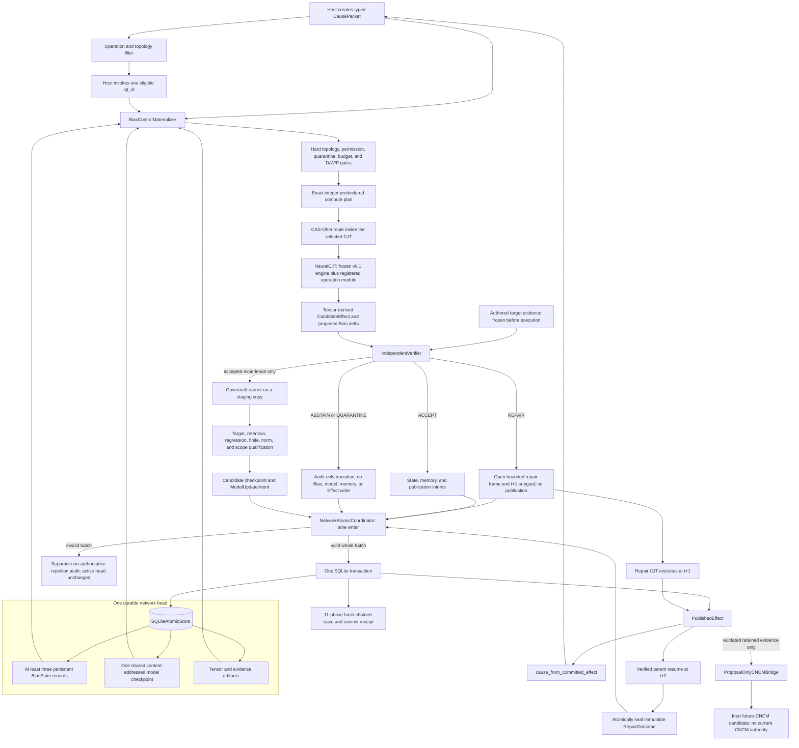
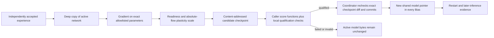

# Neural CJT v0.2 architecture

Status: `IMPLEMENTED LOCAL MECHANISM PROTOTYPE`

This diagram describes the code that exists in v0.2. It does not describe a
finished language model, a production scheduler, or the current CNCM runtime.

## Implemented system



The network selector filters nodes by the Cause's requested operation and, for
an Effect Cause, by a configured directed edge. The runtime caller still names
the one `cjt_id` to execute. CAS-Ohm does not choose among all CJTs. It routes
token/key paths inside that already selected CJT.

The topology is fixed when `NeuralCJTNetwork` is constructed. The active
candidate set can change with each Cause, but v0.2 does not mutate topology at
runtime and does not provide an autonomous network scheduler.

## Authority boundaries

| Component | May do | May not do |
|---|---|---|
| Network selector | Filter operation- and edge-compatible CJTs | Verify, publish, or commit |
| Bias/control materializer | Rebuild exact neural controls from the durable head | Change the head or invent missing artifacts |
| CAS-Ohm router | Gate and weight admitted neural paths; derive local compute ceilings | Decide semantic truth, permission, or commitment |
| Neural CJT | Produce tensors and proposals | Self-verify, publish, or write durable state |
| Deterministic decoder | Derive the small semantic payload from exact tensor bytes | Decide whether that payload is correct |
| Independent verifier | Bind Cause, Bias, model, contract, candidate, and evidence; issue a verdict | Write state or publish an Effect |
| Governed learner | Build and score a candidate update on a copy | Run `optimizer.step()` on the active model |
| Network coordinator | Validate the whole batch and perform the sole atomic write | Trust the candidate's own authority claim |
| CNCM bridge | Emit a frozen, non-authoritative candidate envelope | Create a current CNCM state, proof, intent, action, or halt |

The trusted local `NeuralCJTRuntime` executes the neural forward. The
coordinator validates its proposal, exact configured contracts, semantic
verifier result, permissions, and atomic transition, but it does not rerun or
attest the forward computation. The retained transition is sufficient for
inspection and as input to a future replay tool; it is not a replay or remote
attestation receipt by itself.

## Bias and global model

For CJT `j`, the persisted Bias is:

```text
B[j,t] = (stable, memory, rpm, operating, theta, governance)
```

- `stable` binds the CJT identity, formation version, operation identity,
  specialization tags, lineage, and configuration digest.
- `memory` holds the recurrent tensor reference plus bounded accepted-work
  histories: recent Cause IDs, recent **candidate** Effect IDs, verifier IDs,
  repair IDs, and the IDs/provenance of memory records actually retrieved.
  Published Effect IDs remain in commit/trace evidence. Rejected and repair
  evidence remains durable in the sealed transition rather than being copied
  into Bias memory as though it were accepted experience.
- `rpm` holds separate Desire, Wisdom, and Power records plus open repairs,
  suspended work, return addresses, and repair history.
- `operating` holds the region and semantic outcome as separate fields.
- `theta` points to the shared model artifact and declares this CJT's allowed
  parameter groups, beta units, profile, and adapters.
- `governance` holds hard permissions, compute ceilings, quarantine, write
  authorities, and owner restrictions.

`stable` does not duplicate neural weights. All Biases in one
`NetworkStateEnvelope` point to the same model ID, version, digest, and
checkpoint artifact. A qualified selective update changes only allowlisted
parameter bytes, but the new shared checkpoint pointer is propagated through
every Bias in the same commit.

## Inference transition

Every inference commit records this order exactly once:

```text
READ -> CANDIDATE -> READINESS -> ROUTE -> EXECUTE -> OBSERVE
-> VERIFY -> DIAGNOSE -> EMIT -> COMMIT -> TRACE
```

An accepted candidate can update the invoked CJT's recurrent Bias, propose a
memory record, and become a `PublishedEffect`. A semantic opposite or off-axis
result can update only the repair state and open a subgoal eligible at the next
tick. Cutoff, missing evidence, experimental-operation output, and breakdown
cannot publish an Effect.

An audit-only tick may advance the global envelope and seal a trace while
leaving all Bias, model, memory, and Effect content unchanged. An invalid batch
does not advance the authoritative head; it adds only a separate
non-authoritative rejection audit.

In v0.2, a `QUARANTINE` verifier disposition fails the current candidate
closed and is retained as an audit-only transition. It does not set the
persistent `Governance.quarantined` flag. Persistent quarantine and release
authority require a later governance contract.

## Repair timing

```text
tick t:     parent candidate is rejected -> repair frame is committed
tick t+1:   repair CJT processes the typed RPM subgoal
tick t+2:   the repair's committed Effect may become a Cause that resumes parent work
            -> accepted resumption closes live RPM state and seals RepairOutcome
```

v0.2 permits one open repair globally. Opening requires a distinct,
canonical-admitted `^6` repair CJT with a durably eligible route from the
suspended CJT and a return edge back. The next two global ticks are reserved:
first for the exact stored subgoal, then for the exact Effect-derived resume.
Unrelated work cannot consume either tick. A non-accepted repair attempt is
rejected before authoritative tick advancement, so the same subgoal remains
retryable; v0.2 does not retain such failed attempts as committed cognitive
history. Model learning is not allowed on the reserved repair-subgoal tick.

The resume Cause takes its operation list and goal context from the retained
parent Cause, not from new caller claims. This proves exact return routing and
closure. It does not prove that the repair corrected the parent's original
semantic error.

Depth, branch, cycle, and budget checks are local bounded prototype controls.
They are not a general planning or recursion system.

The original `RepairFrame` remains immutable and records the `OPEN` event. A
separate digest-bound `RepairOutcome` records the `RETURNED` closure, the
committed repair Effect, reconstructed resume Cause, accepted candidate and
verifier receipt, and exact pre-transition Bias. Both records are retained.

## Learning transition



The demo proves that model bytes can change only inside C's operation scope and
that unrelated bytes remain identical. It proves a later output changed after
restart. It does not prove that the change is useful learning outside the
synthetic objective, that retention tests are comprehensive, or that CAS
learns better than a matched baseline.

## Persistence and trace boundary

The supported semantic write boundary is `NetworkAtomicCoordinator`. The raw
`SQLiteAtomicStore.commit(AtomicWriteSet)` call is a trusted internal
coordinator-to-storage primitive for atomic persistence; it is not a validator
for untrusted proposals. External callers must not use it to bypass the network
coordinator's checks.

The module-level legacy `AtomicCoordinator` is retained only as a trusted
single-Bias persistence and rollback compatibility harness. It is not a
package-root public semantic API and rejects `StateUpdateIntent`,
`ModelUpdateIntent`/model-version, and `RepairFrame` inputs. The implemented
neural-CJT path uses
`NetworkAtomicCoordinator`, which replays the semantic rules, proves the
distinct bidirectional repair route, and checks the exact post-state
transition.

The successful transaction retains the state envelope, model version,
artifacts, Cause, candidate Effect, semantic evidence, verifier and
qualification receipts, intents, repair frames, Published Effects, commit
receipt, and trace. `reconstruct_transition(trace_id)` resolves these retained
records, and `verify_integrity()` checks cross-links and chains.

The SHA-256 chains are tamper-evident checksums. They are not digital
signatures, authenticated actor identity, independent timestamps, remote
attestation, or write-once-read-many (WORM) storage.
