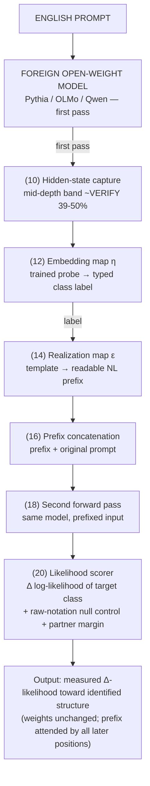
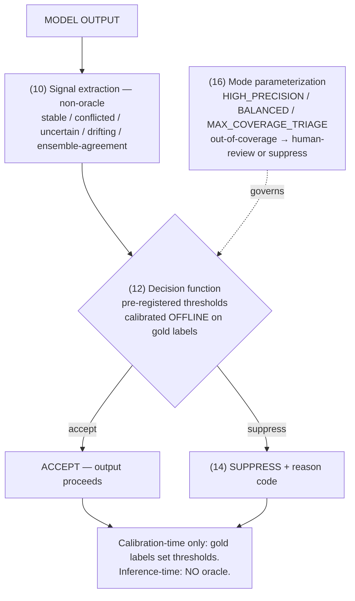
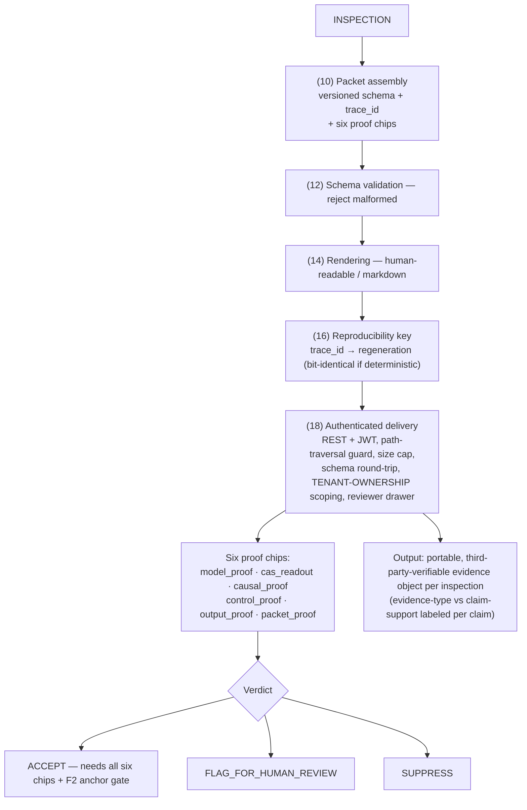
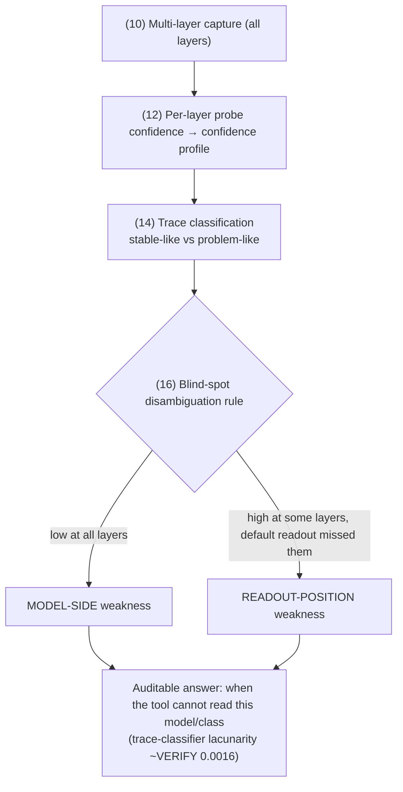
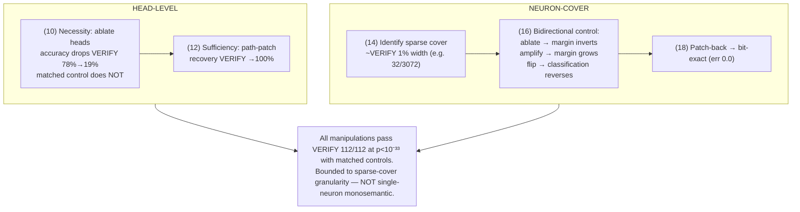
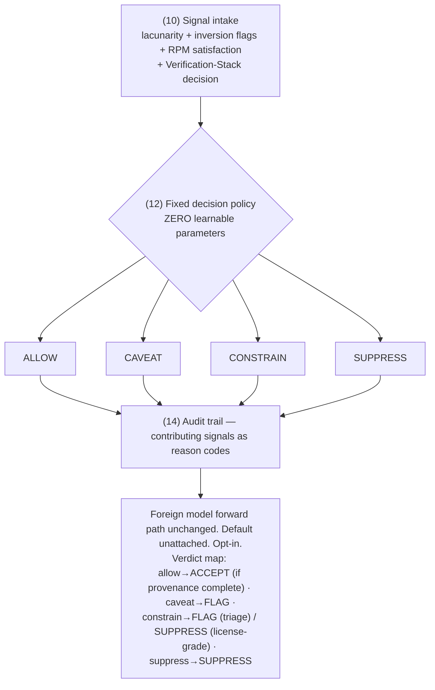
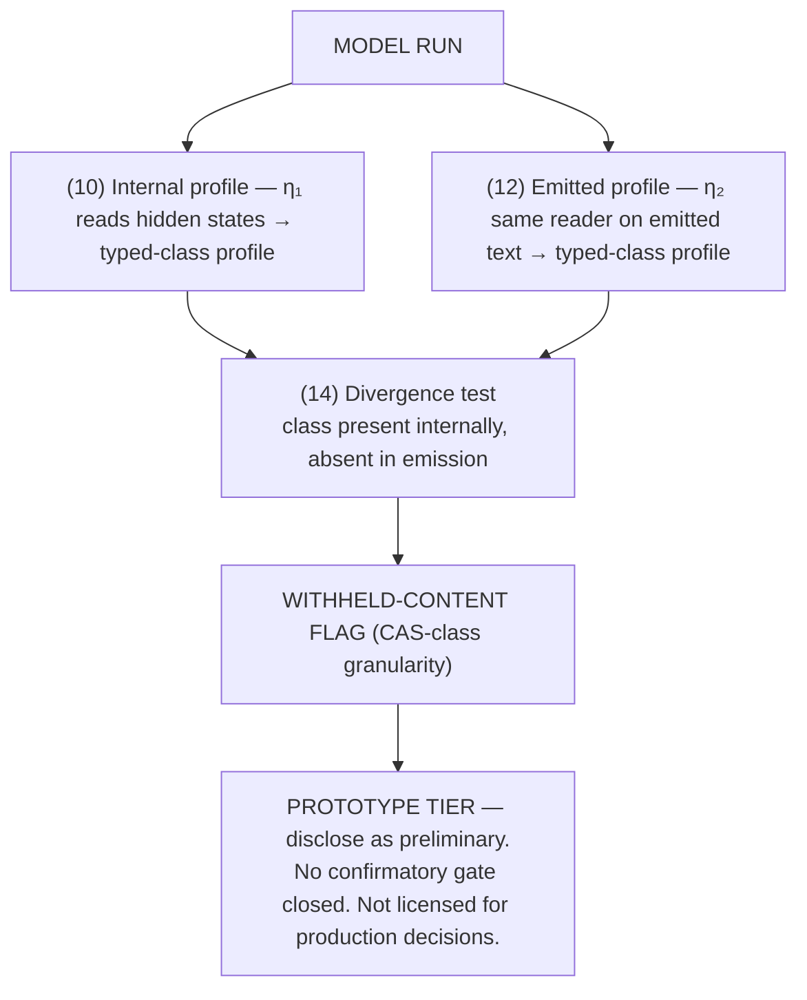
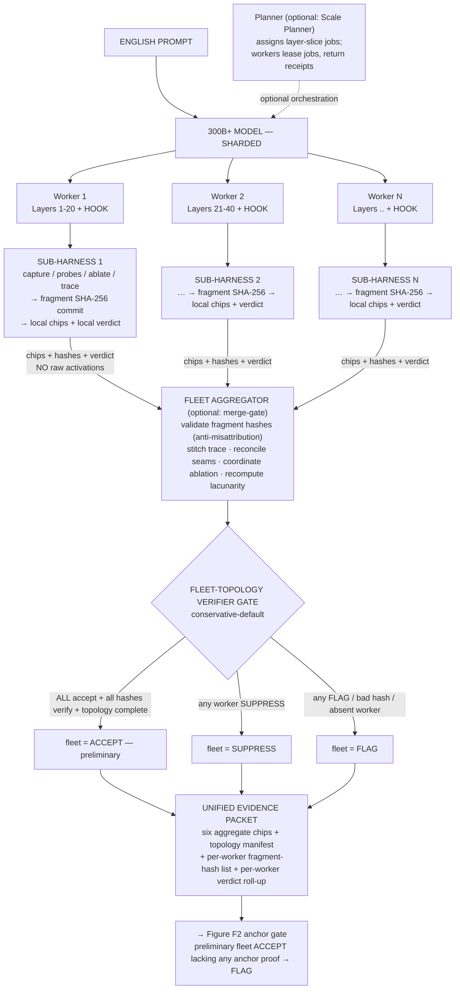
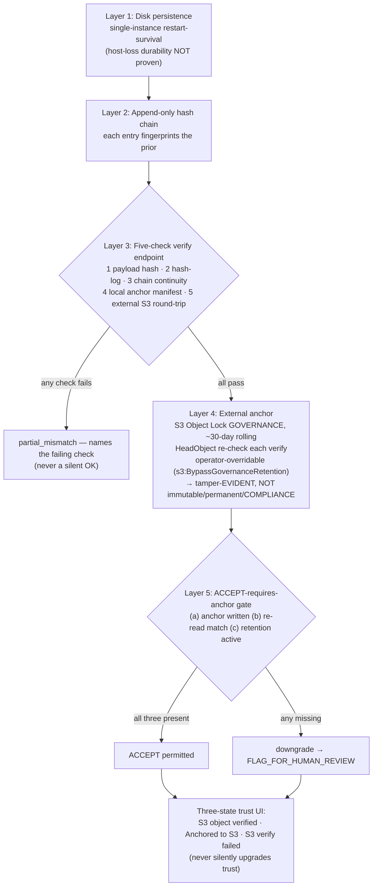

> **DRAFT — must be reviewed by a registered patent attorney/agent before filing; not legal advice.**
> **Public disclosure of these contents may start statutory bars — keep confidential.**
>
> **Purpose of this document.** It re-describes each provisional flowchart as **text + a mermaid diagram** so an attorney or technical illustrator can produce clean, filing-grade figures. **The diagrams cannot be reproduced as the original raster images here** — this captures each figure's *logic and numbered elements* instead. Element numbers (10, 12, 14, …) match the reference numerals used in `CAS_provisional_patent_updated.md` §5. The legacy figures in `CAS_Provisional_Flowcharts.pdf` are stylistically degraded and several labels are unreadable; treat the descriptions below as the corrected source of truth and **re-draw** rather than trace.
>
> **Reconciliation note.** These descriptions are updated to the **current** build: three-verdict vocabulary (`ACCEPT` / `FLAG_FOR_HUMAN_REVIEW` / `SUPPRESS`), **six** proof chips, **GOVERNANCE-mode tamper-evident** anchoring (not immutable), the `ACCEPT`-requires-anchor downgrade gate, and the new **Fleet** figure (H1). Where a legacy figure asserted a headline result (e.g., a standing `ACCEPT`, specific effect sizes), the description **drops the result and keeps the mechanism**, with values marked **[VERIFY]**.

---

# CAS Provisional — Flowcharts Re-Described (Text + Mermaid)

**Figure index**
- **Figure A1** — η→ε conditioning bridge (two-pass, weight-frozen).
- **Figure B1** — Non-oracle runtime verification stack (accept / suppress).
- **Figure C1** — Evidence Packet assembly + authenticated delivery (six chips, three verdicts).
- **Figure D1** — Multi-layer trace + readout-position blind-spot disambiguation.
- **Figure E1** — Matched-control causal localization (head-level + sparse-neuron-cover).
- **Figure F1** — Generation Readiness Gate (four-tier, zero-parameter, non-mutating).
- **Figure G1** — Two-bridge hidden-content detector (η₁/η₂) — **PROTOTYPE**.
- **Figure H1** — Sharded-Fleet execution (NEW; per-worker sub-harness + anti-misattribution + conservative-default gate).
- **Figure F2** — Integrity chain + WORM anchoring detail (NEW; supports Mechanism F).

---

## Figure A1 — η→ε Conditioning Bridge

**Caption:** Two-pass read–realize–condition loop; **no weight modification**. Identity relations: ε∘η = id; η∘ε ≠ id. The realized prefix is ordinary input tokens, attended to by all later positions by construction.

**Logic (numbered elements):**
1. **ENGLISH PROMPT** → enters a **FOREIGN OPEN-WEIGHT MODEL** (e.g., Pythia/GPT-NeoX, OLMo, Qwen). First (baseline) pass.
2. **(10) Hidden-state capture** — capture activations at a mid-depth band (~**[VERIFY 39–50%]** of depth) at **[VERIFY token position(s)]**.
3. **(12) Embedding map η** — trained linear/logistic probe → typed class label.
4. **(14) Realization map ε** — template/lookup emits a readable natural-language prefix for the label.
5. **(16) Prefix concatenation** — prefix + original prompt.
6. **(18) Second forward pass** — same model, prefixed input.
7. **(20) Likelihood scorer** — log-likelihood shift of the target class (prefixed vs. unprefixed); plus null-control (raw-notation prefix ≈ 0) and partner-margin conditions.

---

## Figure B1 — Non-Oracle Runtime Verification Stack

**Caption:** Runtime accept/suppress using **non-oracle** signals; **gold labels at calibration only**, never at inference. Every suppression carries a reason. *(Headline metrics from the legacy figure are **offline-validation** numbers, not production — keep them out of the figure or label them as such.)*

**Logic (numbered elements):**
1. **MODEL OUTPUT** enters.
2. **(10) Signal extraction (non-oracle)** — stable / conflicted / uncertain / drifting / ensemble-agreement (in one embodiment, 2-of-3 across focus / final / mean-over-sequence readouts).
3. **(12) Decision function** — pre-registered thresholds, calibrated offline. Branches to **ACCEPT** (output proceeds) or **(14) SUPPRESS + reason code**.
4. **(16) Mode parameterization** — HIGH_PRECISION / BALANCED / MAX_COVERAGE_TRIAGE; rows outside calibrated coverage route to human-review/suppress, never low-confidence accept.

---

## Figure C1 — Evidence Packet Assembly + Authenticated Delivery

**Caption:** Versioned, validated, reproducible, **tenant-scoped authenticated** audit artifact — the portable deliverable. Carries one of three verdicts and six proof chips. *(Reserved language: never "irrefutable / proven / guaranteed / certified.")*

**Logic (numbered elements):**
1. **INSPECTION** enters.
2. **(10) Packet assembly** — versioned schema; includes `trace_id`, the CAS expression, input, output, detected labels, causal-test results, verdict, provenance, hashes, and the **six proof chips** (`model_proof`, `cas_readout`, `causal_proof`, `control_proof`, `output_proof`, `packet_proof`). *(Legacy "15-field" count is **[VERIFY]**.)*
3. **(12) Schema validation** — reject malformed.
4. **(14) Rendering** — human-readable / markdown.
5. **(16) Reproducibility key** — `trace_id` (+ artifact hashes) → regeneration (bit-identical where deterministic).
6. **(18) Authenticated delivery** — REST + JWT, path-traversal guard, size cap, schema round-trip, **tenant-ownership scoping**, reviewer drawer.
7. **VERDICT** — exactly one of `ACCEPT` / `FLAG_FOR_HUMAN_REVIEW` / `SUPPRESS`; a customer-safe `ACCEPT` requires all six chips present/verified **and** the Figure F2 anchor gate.

---

## Figure D1 — Multi-Layer Trace + Readout-Position Blind-Spot Disambiguation

**Caption:** Separates **model-side** weakness from **readout-position** weakness. Answers "when can the tool NOT read this model/class?"

**Logic (numbered elements):**
1. **(10) Multi-layer capture** — activations at all layers (or a defined set).
2. **(12) Per-layer probe confidence** → confidence profile.
3. **(14) Trace classification** — stable-like vs. problem-like **[VERIFY classifier]**.
4. **(16) Blind-spot disambiguation rule** — branches to **MODEL-SIDE weakness** (low at all layers) or **READOUT-POSITION weakness** (high at some layers, missed by default readout).

---

## Figure E1 — Matched-Control Causal Localization

**Caption:** Necessity + sufficiency + **bidirectional** control, **matched-control validated**, bit-exact patch-back. **Bounded to sparse-cover granularity — NOT single-neuron monosemantic.** Two parallel tracks: head-level and neuron-cover.

**Logic (numbered elements):**
- **Head-level track:** **(10) Necessity** — ablate heads → accuracy drops **[VERIFY 78%→19%]** (matched control does not). **(12) Sufficiency** — path-patch → recovery **[VERIFY →100%]**.
- **Neuron-cover track:** **(14) Identify sparse cover** (~**[VERIFY 1% width, e.g., 32/3072]**). **(16) Bidirectional control** — ablate → margin inverts; amplify → margin grows; polarity-flip → classification reverses. **(18) Patch-back** → bit-exact (err 0.0).

---

## Figure F1 — Generation Readiness Gate (four-tier, zero-parameter, non-mutating)

**Caption:** Zero-parameter, **non-mutating**, four-tier action policy. Foreign-model forward path unchanged; default unattached; opt-in.

**Logic (numbered elements):**
1. **(10) Signal intake** — lacunarity + inversion flags + RPM/prerequisite satisfaction + Verification-Stack decision (+ gap / domain-confidence) **[VERIFY exact list]**.
2. **(12) Fixed (non-learned) decision policy** — zero learnable parameters → exactly one of **ALLOW / CAVEAT / CONSTRAIN / SUPPRESS**.
3. **(14) Audit trail** — action + contributing signals as reason codes.

---

## Figure G1 — Two-Bridge Hidden-Content Detector (η₁/η₂) — PROTOTYPE TIER

**Caption:** Compares internal vs. emitted structure to surface withheld content. **Prototype — disclose as preliminary; not licensed for production accept/suppress.**

**Logic (numbered elements):**
1. **MODEL RUN** enters.
2. **(10) Internal profile** — η₁ reads hidden states → typed-class profile.
3. **(12) Emitted profile** — same typed-class reader (η₂) on emitted text → typed-class profile.
4. **(14) Divergence test** — class present internally but absent in emission → **WITHHELD-CONTENT FLAG** (typed-class granularity) **[VERIFY metric/threshold]**.

---

## Figure H1 — Sharded-Fleet Execution (NEW)

**Caption:** Frontier-scale audit of a model too large for one worker. Per-worker sub-harness; **fragment SHA-256 anti-misattribution**; **conservative-default** fleet gate; **raw activations never cross the wire**. Unified packet inherits the Figure F2 anchor gate.

> **[VERIFY orchestration vocabulary.]** The validated, code-grounded names are **Fleet Executor**, per-worker **sub-harness**, **Fleet Aggregator**, **fleet-topology verifier gate**. The user-supplied orchestration terms — **Scale Planner**, shard/layer **jobs**, **leases**, **receipts**, **merge-gate** — are shown as optional embodiments (dashed) and must be confirmed against the implementation before being recited in claims.

**Logic:**
1. **ENGLISH PROMPT** → **300B+ MODEL — SHARDED** across **Workers 1..N** (each holds a layer range; each has a hook).
2. **Planner** (optional "Scale Planner") assigns **layer-slice jobs**; workers (optional) **lease** jobs and return **receipts**.
3. **Per-worker SUB-HARNESS** — capture / probes / ablate / trace locally → **fragment SHA-256 commit** → **local chips + local verdict**.
4. Only **chips + hashes + local verdicts** travel the wire (no raw activations).
5. **FLEET AGGREGATOR** (optional "merge-gate") — validate fragment hashes (anti-misattribution), stitch multi-layer trace, reconcile shard seams, coordinate cross-worker ablation, recompute lacunarity.
6. **FLEET-TOPOLOGY VERIFIER GATE (conservative-default)** — any worker SUPPRESS → fleet SUPPRESS; any worker FLAG → fleet FLAG; any invalid fragment hash → fleet FLAG; any absent/timed-out worker → fleet FLAG; **only if all N ACCEPT + all hashes verify + topology complete** → fleet ACCEPT (preliminary).
7. **UNIFIED EVIDENCE PACKET** — six aggregate chips + fleet-topology manifest + per-worker fragment-hash list + per-worker local-verdict roll-up + preliminary fleet verdict.
8. → **Figure F2 anchor gate**: a preliminary fleet `ACCEPT` lacking any of the three anchor proofs is downgraded to `FLAG_FOR_HUMAN_REVIEW`.

---

## Figure F2 — Integrity Chain + WORM Anchoring Detail (NEW; supports Mechanism F)

**Caption:** Five-layer tamper-EVIDENT integrity chain. **GOVERNANCE-mode, ~30-day rolling, operator-overridable** — **NOT immutable, NOT permanent, NOT COMPLIANCE-mode.** The `ACCEPT` verdict is gated on three anchor proofs; missing any → downgrade to `FLAG_FOR_HUMAN_REVIEW`.

**Logic:**
1. **Disk persistence** (single-instance restart-survival; **host-loss durability NOT proven**).
2. **Append-only hash chain** (each entry fingerprints the prior).
3. **Five-check verify endpoint** — payload hash · hash-log entry · chain continuity · local anchor manifest · external S3 round-trip; on any failure, name the failing check (never silent OK).
4. **External anchor** — S3 Object Lock **GOVERNANCE**, ~30-day rolling; `HeadObject` re-checks `ObjectLockMode==GOVERNANCE` and `RetainUntilDate` in future on each verify; **operator-overridable via `s3:BypassGovernanceRetention`** → guarantee is tamper-evidence on re-verify, not immutability.
5. **ACCEPT-requires-anchor gate** — needs (a) anchor written, (b) re-read hash-match, (c) retention active; missing any → **FLAG_FOR_HUMAN_REVIEW**.
6. **Three-state trust UI** — "S3 object verified" / "Anchored to S3" / "S3 verify failed"; never silently upgrades.

---

## Illustrator / attorney notes

- **Re-draw, do not trace.** The legacy raster figures are degraded; use these descriptions + mermaid as the corrected source.
- **Keep numerals consistent** (10, 12, 14, …) with §5 of the spec so the text's references resolve.
- **Honest labels only.** On Figure F2/H1, do not let "immutable / permanent / certified / guaranteed" re-enter; the anchor is **tamper-evident, operator-overridable, ~30-day GOVERNANCE**.
- **Prototype marking.** Figure G1 must visibly carry "PROTOTYPE — preliminary."
- **No headline results in figures.** Drop any standing-`ACCEPT` or effect-size claims from figure faces; those belong (with `[VERIFY]`) in the Example-Results prose, labeled offline-validation where applicable.
- **Fleet orchestration terms** (Scale Planner / lease / receipt / merge-gate) are shown dashed/optional pending implementation confirmation; the solid path uses the validated terms (Fleet Executor / sub-harness / Fleet Aggregator / fleet-topology gate).

**END — CAS_provisional_flowcharts_described.md — DRAFT for attorney/illustrator. Not legal advice. Keep confidential.**
