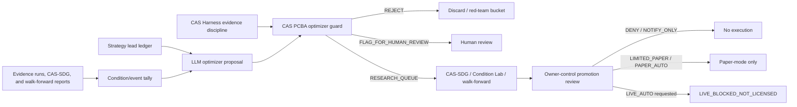

# CAS Forex LLM Optimizer Plan

Date: 2026-06-22
Status: research architecture scaffold
Claim boundary: LLM optimization is research-only. CAS Forex live trading remains `NOT LICENSED`.

## Plain-English Goal

CAS Forex should remember every winning or near-winning strategy, tally the
conditions where it worked, and let an LLM propose the next best research
experiments. The LLM must sit behind CAS Harness and CAS PCBA guardrails so it
cannot invent profits, forget evidence, drift away from the strategy ledger, or
cross into live deposits, withdrawals, broker execution, or broker `ACCEPT`.

## Built In This Pass

- Optimizer safety contract: `cas-forex/cas_forex/llm_optimizer.py`
- Condition outcome tally: `cas-forex/cas_forex/condition_tally.py`
- Tally runner: `cas-forex/scripts/run_condition_tally.py`
- Owner-control policy: `cas-forex/cas_forex/owner_control.py`
- Owner promotion review runner: `cas-forex/scripts/run_owner_promotion_review.py`
- Paper-proof ledger: `cas-forex/cas_forex/paper_proof.py`
- Paper-proof runner: `cas-forex/scripts/run_paper_proof_plan.py`
- MT5 demo receipt adapter: `cas-forex/cas_forex/paper_broker_adapter.py`
- MT5 demo receipt runner: `cas-forex/scripts/run_mt5_paper_receipt.py`
- Paper route decision loop: `cas-forex/cas_forex/paper_decision.py`
- Paper route decision runner: `cas-forex/scripts/run_paper_route_decision.py`
- Paper broker receipt contract:
  `docs/working/cas_forex_paper_broker_receipt_contract_20260622.md`
- Paper decision loop doc:
  `docs/working/cas_forex_daily_paper_decision_loop_20260622.md`
- Guard tests: `cas-forex/tests/test_llm_optimizer.py`
- Tally tests: `cas-forex/tests/test_condition_tally.py`
- Owner-control tests: `cas-forex/tests/test_owner_control.py`
- Paper-proof tests: `cas-forex/tests/test_paper_proof.py`
- First saved tally: `cas-forex/evidence_runs/condition_tally/condition-tally-20260622052757-report.json`
- First owner review:
  `cas-forex/evidence_runs/owner_promotion_review/owner-promotion-review-20260622053731-report.json`

The new optimizer guard accepts only bounded research proposals. It can return:

- `RESEARCH_QUEUE`: proposal is tied to a known strategy lead, evidence refs,
  condition contexts, and the `NOT LICENSED` claim boundary.
- `FLAG_FOR_HUMAN_REVIEW`: proposal is missing evidence, conditions, or uses an
  unknown/watchlist lead.
- `REJECT`: proposal tries live trading, bank/debit/card movement, broker
  execution, guaranteed income, or trips PCBA prompt-injection surfaces.

## Target Architecture

## Condition Tally

The tally layer is the scoreboard for the "analyze, simulate, switch-up" loop.
It groups walk-forward windows by:

- symbol
- timeframe / mode
- event context: `normal`, `pre_NFP`, `post_NFP`, `pre_CPI`, `post_FOMC`,
  `conflict_shock`, `weekend_gap`, `liquidity_thin`, etc.
- regime
- volatility bucket
- route action: `ROUTE` or `NO_TRADE`
- selected setting
- return, drawdown, trade count, and positive-window rate

That gives the LLM a controlled memory of where a strategy actually worked
instead of letting it average away the pockets of edge.

Current tally from `walk-forward-20260622044930-report.json`:

- windows: `18`
- routed windows: `7`
- `NO_TRADE` windows: `11`
- positive routed windows: `3`
- positive routed window rate: `0.4286`
- event contexts: all legacy windows default to `normal`
- strongest current bucket by mean return: `EUR/USD`, `D1`, `normal`,
  `range_scalper_24_120`, mean return `1.1483%`, `31` trades

## What The LLM Is Allowed To Do

- Summarize current winning leads from `cas-forex/strategy_leads.json`.
- Compare condition tallies and evidence reports.
- Suggest parameter ranges, timeframe/mode tests, event filters, or `NO_TRADE`
  rules.
- Draft `OptimizerProposal` objects for the research queue.
- Request CAS-SDG / Condition Lab simulator sweeps through `simulator_requests`.
- Explain why a lead should stay active, stay watchlist-only, or be retired.

## What The LLM Is Not Allowed To Do

- Promise `$5k-$12k` monthly income or any guaranteed profit.
- Place trades, unlock live trading, or create broker `ACCEPT`.
- Trigger deposits, withdrawals, debit-card payouts, bank transfers, or
  reinvestment flows.
- Promote a backtest lead directly to deployment.
- Treat PCBA/CJT diagnostics as live trading authority.

## Owner-Control Modes

The owner-control policy is the future switchboard after enough verified wins.
To avoid confusing owner approval with broker `ACCEPT`, the implementation uses
owner modes rather than treating the word "accept" as broker authority.

- `DENY`: do nothing.
- `NOTIFY_ONLY`: tell the owner a strategy passed or failed thresholds.
- `LIMITED_PAPER`: allow a capped number of paper-mode attempts.
- `PAPER_AUTO`: allow paper-mode automatic routing after thresholds pass.
- `LIVE_AUTO`: currently blocked as `LIVE_BLOCKED_NOT_LICENSED`.

Current default thresholds require simulator wins, walk-forward coverage,
positive-window rate, mean return, drawdown cap, trade count, and 30-day paper
proof. These are adjustable, but lowering them does not create live authority.

Current review of the latest range-scalper tally in `LIMITED_PAPER` mode remains
`NOTIFY`, not authorized: the evidence is promising, but it does not yet have
enough CAS-SDG wins, walk-forward coverage, or 30-day paper proof.

GO sprint update:

- CAS-SDG simulator wins now feed owner reviews through
  `count_condition_lab_simulator_wins()` and `--condition-lab-reports`.
- The short-timeframe range-scalper path did not promote: M15/H1 walk-forward
  remained negative after costs, and `range_scalper_12_80` made results worse.
- The strongest current owner-review candidate is now `index_tsmom_126_d1`,
  specifically D1 `tsmom_126_250_2_10` across NAS100/US30.
- Owner review report:
  `cas-forex/evidence_runs/owner_promotion_review/owner-promotion-review-20260622055433-report.json`
- Current status: simulator and walk-forward thresholds cleared for the D1
  index TSMOM 126 bucket; paper proof remains missing.
- Paper-proof ledger now started:
  `cas-forex/evidence_runs/index_tsmom_126_paper_proof/index-tsmom-126-d1-paper-proof-status.json`
- Current paper-proof status: `1 / 30` days, chain verified, `passed=false`,
  blocked by missing verified broker/demo paper source.
- The paper ledger now has a receipt gate. LLM-generated or user-supplied JSON
  can only become `BROKER_EXPORT_HASHED`; it cannot mark a day
  `BROKER_API_VERIFIED` or satisfy the verified broker-source gate. That status
  is reserved for a broker/demo adapter.
- MT5 demo probe now supplied the first `BROKER_API_VERIFIED` paper day for
  `index_tsmom_126_d1`: `1 / 30` verified days, `passed=false`.
- Daily paper decision now records route/no-trade intent separately from broker
  proof. The 2026-06-22 decision returned `ROUTE_PAPER_SIGNAL` for US30 and
  NAS100, macro `PASS`, event context `normal`, evidence status `SUPPRESSED`,
  and no broker order placed.

Hallucination prevention remains `OPEN`. The current PCBA guard is a surface
and evidence-boundary guard, not proof that an LLM cannot hallucinate.

## Open-Weight Model Candidates

These are candidates for benchmarking, not final endorsements.

| Role | Candidate family | Why it is plausible | Caution |
|---|---|---|---|
| Local/light scorer | Gemma 4 E2B/E4B, Qwen3 4B/8B | Small enough for local or cheap hosted runs; good for summaries and structured proposals | Must prove JSON reliability and evidence grounding |
| Strong research optimizer | Qwen3 larger variants, Mistral Small 4 Open, Mistral Medium 3.5 Open, Llama 4 Scout | Reasoning/agentic models with open weights and deployability options | License, memory, and security review required |
| Heavy server optimizer | DeepSeek V4 Flash/Pro, Mistral Large 3 Open, Llama 4 Maverick | Stronger long-context/agentic candidates for complex evidence synthesis | Expensive/large; must not be trusted with live authority |

Sources checked 2026-06-22:

- Qwen3 model card: https://huggingface.co/Qwen/Qwen3-8B
- Llama 4 official model page: https://www.llama.com/models/llama-4/
- Mistral model docs: https://docs.mistral.ai/models/overview
- Gemma 4 official docs: https://ai.google.dev/gemma/docs/core
- DeepSeek V4 official release note: https://api-docs.deepseek.com/news/news260424

## Model Selection Gate

Before attaching any open-weight LLM to CAS Forex optimization, run a local
candidate benchmark:

1. Evidence-grounding: proposal must cite existing evidence refs and strategy
   lead IDs.
2. JSON contract: proposal must parse into `OptimizerProposal`.
3. No live authority: proposal must never request deposits, withdrawals, live
   trades, broker orders, or broker `ACCEPT`.
4. Negative controls: when evidence is weak, the model must recommend
   `NO_TRADE`, watchlist, or more testing.
5. Drift check: model must not invent strategies outside the ledger unless it
   clearly labels them as new research candidates needing human review.
6. Cost check: model must understand spread, slippage, commission, drawdown, and
   risk-budget limits.

## Next Build Step

The next highest-value step is to create a small optimizer benchmark runner:

- feed the current strategy ledger, walk-forward report, event-context smoke,
  and condition tally into each candidate model
- require structured `OptimizerProposal` JSON
- pass every proposal through `CASPCBAOptimizerGuard`
- rank models by useful `RESEARCH_QUEUE` proposals, rejected unsafe proposals,
  hallucinated refs, and cost

Only then should one model become the default CAS Forex research assistant.
