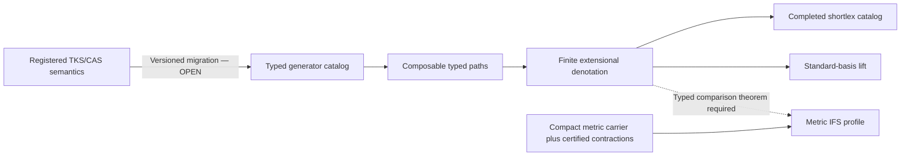

# Typed Noetic Dynamics and Finite Fractal Semantics

Publication delta: `v0.1`

Control status: `DRAFT / OPEN / RING 4 / NOT LICENSED / HELD / NOT FROZEN`

Charter track: Paper 1 of the Project Coherence publication architecture

Source baseline: Git commit `a1cd990109e7561dfd03949bf0e1653461c7ae44`

## Abstract

This paper-shaped delta isolates a defensible finite mathematical core for a
future TKS v8 publication.  It does not replace the existing TKS v8 candidate
specification or the v7.4 corrigendum.  Its purpose is to make their mathematical
dependency structure explicit and to separate four notions that earlier TKS
materials sometimes blended: typed inter-object paths, powers of one endomap,
linear lifts of deterministic maps, and metric iterated-function systems.

The supported core consists of the category of named finite sets and typed total functions; a
standard-basis lift that preserves identities and composition at the checked
entry, basis-action, and support levels; the exact maximum-fiber formula for the
lift norm; a finite denotational shortlex catalog; and elementary stabilization
results for fixed finite maps and finite set operators.  Existing executable
evidence exhaustively checks bounded carriers, and existing Lean modules
kernel-check a strict subset of the categorical and lift statements.  The
universal norm theorem, the generic matrix/Gram/trace/rank bridge, the shortlex
leastness proof, factorial idempotence, exact/approximate calculus, v7.4 semantic
migration, and independent specialist review remain open.

We therefore use **finite fractal semantics** only as a typed two-layer term:
(i) finite denotational closure under explicitly composable generators and
(ii) an optional metric IFS profile that may invoke classical attractor theory
only after compactness and contraction hypotheses have been established.  No
empirical cognition claim, transfinite convergence claim, product claim,
canonical promotion, or release authority follows.

## 1. Publication and authority boundary

This is a delta over the existing artifacts, not a new specification.  The
controlling sources are identified byte-for-byte in
`SOURCE_INVENTORY_v0.1.json`.  In particular:

- the Project Coherence charter remains `DRAFT / OPEN / NOT FROZEN`;
- the TKS v7.4 corpus remains a frozen source identity with correction overlays,
  not a blanket source of inherited theorems;
- the TKS v8 typed core remains a Ring-4 reference candidate;
- the shared theorem, claim, symbol, source-authority, and migration registries
  are read-only dependencies of this publication lane; and
- existing Gate 1 verification proves only the hash-bound and scoped candidate
  checks it actually performs.

All statements introduced by this delta remain publication-draft statements.
Where an existing Lean artifact proves a narrower fragment, the matrix records
that fragment as kernel-checked without promoting the surrounding publication
claim.  “Formally verified fragment” is not “the paper is formally verified.”

The ten canonical Noetic names and definitions are not redefined here.  The
local mathematical word *noetic* means only “a versioned generator that a
future semantic migration may associate with a source-bound Noetic operator.”
No such association is inferred from a Python function, a matrix, a digit, or a
display name.

**Figure 1.** Dependency boundary for this draft.  Current candidate evidence
attaches to the finite lane; the metric lane is standard literature background
only.  The semantic migration and any cross-layer bridge remain open.

## 2. Typed finite dynamics

### 2.1 Objects, arrows, and composition

Let \(\mathcal C_{\mathrm{fin}}\) be the category whose objects are named finite
sets and whose arrows \(f:X\to Y\) are total functions. This category need not
itself have finitely many objects or arrows; a genuinely finite subcategory
would require a frozen finite carrier catalog. Equality of arrows is
extensional equality at a fixed source and target.  Given \(f:X\to Y\) and
\(g:Y\to Z\), composition is

\[
(g\circ f)(x)=g(f(x)).
\]

The source and target belong to the arrow's type.  Consequently, a sequence

\[
X_0\xrightarrow{f_1}X_1\xrightarrow{f_2}\cdots
\xrightarrow{f_r}X_r
\]

is a **typed path** only when each adjacent target and source agree.  This is a
small finite-category or semigroupoid calculation.  It is not automatically a
word in one transformation semigroup.

An **endomap** is an arrow \(f:X\to X\).  Powers \(f^n\), orbit periodicity,
and idempotent-power results are stated only for one fixed endomap (or one fixed
element of a finite semigroup).  A time-varying sequence of different typed
generators has neither a common power nor an eventual-periodicity theorem merely
because every carrier is finite.

The identity and associativity laws are elementary pointwise theorems.  The
existing Python reference model checks them on bounded finite carriers.  The
existing Lean `TypedCategory` module kernel-checks typed-map identities and
associativity, with no project axiom declarations.  Equivalence between the
Python and Lean encodings remains open.

### 2.2 Legacy strings are not self-typing

A legacy digit string or generator name does not determine an arrow.  A
compatibility profile must provide a versioned catalog

\[
\Gamma=(g_0,\ldots,g_{k-1}),\qquad g_i:X_i\to Y_i,
\]

plus the exact source identity and parsing policy.  Decoding succeeds only when
every symbol is present and the resulting arrows compose.  The output is the
typed path and its denotation, not an assertion that the digit has a universal
or canonical meaning.

This distinction is load-bearing for migration: native TKS Worlds, CAS Domains,
CAS Registers, TKS Foundations, and CAS Core Drives remain different registered
semantic types.  A future compatibility parser must emit an explicit crosswalk
record rather than silently collapsing them.

## 3. Deterministic standard-basis lift

### 3.1 Definition and functorial fragment

For a finite set \(X\), let \(H_X=\ell^2(X)\) with orthonormal standard basis
\((e_x)_{x\in X}\).  For \(f:X\to Y\), define

\[
A_f:H_X\to H_Y,\qquad A_fe_x=e_{f(x)},
\]

and extend linearly.  Direct evaluation on basis vectors gives

\[
A_{\mathrm{id}_X}=I_{H_X},\qquad
A_{g\circ f}e_x=A_gA_fe_x.
\]

The existing Lean lift module kernel-checks identity entrywise and on basis
vectors, typed composition on basis vectors, zero/one entry characterizations,
and relational-product support composition.  It deliberately does not yet
formalize finite scalar sums, numerical matrix multiplication, or arbitrary-
vector linearity.  Accordingly the categorical functor into a formally defined
module category remains an open extension even though the basis calculation is
mathematically immediate.

### 3.2 Exact norm, trace, rank, and support

For nonempty \(X\), define the fiber multiplicities

\[
m_y=|f^{-1}(y)|.
\]

Then

\[
\|A_f\|^2=\max_{y\in Y}m_y,
\qquad
\|A_f\|=\sqrt{\max_{y\in Y}m_y}.
\]

For the empty domain we set the norm to zero.  To see the formula, observe that
the \((x,x')\)-entry of \(A_f^*A_f\) is one exactly when \(f(x)=f(x')\).
After grouping the input basis by fibers, \(A_f^*A_f\) is a direct sum of
all-ones blocks \(J_{m_y}\).  Each nonempty block has eigenvalues \(m_y\)
once and zero otherwise, so its largest eigenvalue gives the formula.

The same calculation separates quantities that must not be conflated:

\[
\operatorname{tr}(A_f^*A_f)=|X|,
\qquad
\operatorname{rank}(A_f)=|\operatorname{im}f|.
\]

The operator \(A_f^*A_f\) is the input-collision Gram operator.  Meanwhile
\(A_fA_f^*\) is diagonal on \(H_Y\) with diagonal entries \(m_y\).  The
orthogonal projector onto output support is the different diagonal operator

\[
S_f e_y=\mathbf 1_{m_y>0}e_y.
\]

Thus a many-to-one deterministic lift need not be a contraction, partial
isometry, self-adjoint operator, or orthogonal projector.

### 3.3 Permanent counterexample fixture

For \(X=\{0,1\}\) and the constant map \(f(0)=f(1)=0\),

\[
A_f=\begin{bmatrix}1&1\\0&0\end{bmatrix},\quad
A_f^2=A_f,\quad
\|A_f\|=\sqrt2,\quad
\operatorname{tr}(A_f^*A_f)=2,\quad
\operatorname{rank}(A_f)=1.
\]

This one fixture refutes the inherited universal contraction, occupation-trace,
idempotent-partial-isometry, and orthogonal-projector cluster.  The exact
two-state function and literal arithmetic fixtures are present in Lean, but the
generic bridge from those literals to formal matrix, Gram, trace, and rank
definitions is still open.  The publication must not report that bridge as
completed.

## 4. Finite denotational normal forms

Fix a finite ordered catalog \(G=(g_0,\ldots,g_{k-1})\) of typed generators.
A word includes a start object, and only composable label sequences are
admissible.  Its denotation \(\llbracket w\rrbracket\) is the composite arrow.
Order words by length and then lexicographically by declared generator rank.
For each reachable arrow \(a\), define

\[
\operatorname{NF}_G(a)=
\min_{\mathrm{shortlex}}\{w:\llbracket w\rrbracket=a\}.
\]

Because every source-target hom-set of total maps between fixed finite carriers
is finite, the reachable denotation closure is finite.  A breadth-first
shortlex search that expands only the first representative of each typed
denotation is sound: equal typed prefix denotations remain equal after any
common well-typed suffix, while the earlier prefix retains its shortlex
advantage.  Completion therefore yields the least representative of every
reachable denotation.

The executable candidate separately bounds the accepted-denotation catalog and
the pending frontier.  Exceeding either bound raises an error; it does not emit a
partial table as canonical.  Changing the declared generator order can change
the selected representative without changing the denotation.

This is **denotational enumeration**, not a theorem about an inherited rewrite
system.  A rewrite presentation would require explicit rules plus termination,
confluence, and compatibility results of the kind distinguished in the
Knuth--Bendix literature.  No such inherited TKS rewrite proof is claimed here.

## 5. What “finite fractal semantics” means

The phrase is retained only under the following two-layer definition.

### 5.1 Layer F: finite compositional profile

A finite compositional profile is a tuple

\[
\mathsf F=(\mathcal O,G,\operatorname{Path}(G),
\llbracket-\rrbracket,\operatorname{NF}_G),
\]

where \(\mathcal O\) is a finite set of named finite carriers, \(G\) is a
finite catalog of typed generators, paths are type-correct, denotation is
extensional function composition, and \(\operatorname{NF}_G\) is the completed
denotational shortlex catalog.  “Self-similar” at this layer means only that
the same versioned generator catalog may recur inside composable paths.  It
does not imply a noninteger dimension, metric contraction, unique attractor,
or scale invariance.

For one fixed endomap \(f:X\to X\) on \(|X|=n\), every orbit is eventually
periodic, and \(f^{n!}\) is idempotent.  More generally, if \(s\) is one
element of a finite semigroup \(S\), then \(s^{|S|!}\) is idempotent.  These
are elementary finite-power results.  They do not apply to an arbitrary
time-varying sequence of generators.

For a finite family \(S\) of endomaps of \(X\), define the set operator

\[
H_S(A)=\bigcup_{g\in S}g(A).
\]

Starting from \(X\), monotonicity gives a descending chain
\(H_S^{r+1}(X)\subseteq H_S^r(X)\), which stabilizes in finitely many steps.
The stabilized set is a fixed point and contains every other fixed subset of
\(X\).  This is a finite greatest-stabilized-subset theorem; it is not a
unique metric-attractor theorem.

### 5.2 Layer M: optional metric IFS profile

A metric IFS profile adds a compact metric space \((K,d)\), maps
\(w_i:K\to K\), and certified Lipschitz constants \(c_i<1\).  Only at this
layer may the classical Hutchinson contraction theorem be invoked to obtain a
unique compact attractor in the Hausdorff metric.  A finite carrier, a graph,
or a repeated symbolic pattern does not by itself discharge compactness,
contraction, separation, or dimension hypotheses.

Any proposed TKS interpretation must state which layer it uses.  Mixing Layer F
and Layer M in one theorem is prohibited unless a typed comparison theorem
supplies the metric, the encoding, and the error/loss statement.

## 6. Exact and approximate relations

Exact equality, isomorphism, equivalence, approximation, analogy, and empirical
correlation are separate relations.  An approximate arrow statement must name
the norm or metric and its tolerance.  For bounded linear operators, a safe
composition estimate is conditional on the surrounding norms.  For example,
if \(\|\widetilde f-f\|\leq\varepsilon_f\) and
\(\|\widetilde g-g\|\leq\varepsilon_g\), then

\[
\|\widetilde g\widetilde f-gf\|
\leq \|\widetilde g\|\varepsilon_f+\varepsilon_g\|f\|.
\]

Longer products require the corresponding telescoping factors.  A local
“approximate inverse” error can therefore be amplified.  A future TKS v8
exact/approximate calculus must bind the metric, direction, order, tolerance,
and composition budget; the current candidate does not yet implement that full
calculus.

## 7. Evidence method

The current evidence is intentionally heterogeneous:

1. **Direct finite proofs:** pointwise category laws, the fiber-block norm
   calculation, finite eventual periodicity, and finite stabilization.
2. **Counterexamples:** the two-state constant lift, the two-state swap, and
   alternating inverse partial products retained by the v7.4 corrigendum.
3. **Bounded executable evidence:** 20 TKS v8 tests, including 19,683
   three-point associativity triples, 289 endomaps through carrier size four,
   499 typed maps through source/target size four, and 1,678 lift-composition
   pairs through size three, as reported by the existing manifest.
4. **Scoped formal evidence:** 16 audited Lean declarations in the integrated
   Gate 1 receipt, including typed category and deterministic-lift fragments.
5. **Source audit:** 29 load-bearing v7.4 corrigendum records selected from a
   mechanically scanned surface of 1,258 numbered declarations.  The other
   declarations and 84 unresolved placeholder tokens remain open.

The command `python -B scripts/verify_project_coherence_gate1.py` was replayed
from the frozen publication baseline and returned `PASS`.  That receipt binds
23 top-level artifacts and six subordinate checks; it retains Gate 1 as
`OPEN / Ring 4 / NOT LICENSED / NOT FROZEN`.

## 8. Claim partition

| Claim class | Defensible statement in this draft | Prohibited promotion |
|---|---|---|
| Standard result | Finite typed functions form a category; fixed finite powers stabilize as stated. | “TKS cognition has been proved categorical.” |
| Corrected standard specialization | The standard-basis lift has the maximum-fiber norm and distinct collision/support operators. | “Noetic maps are contractions, channels, unitaries, or projectors.” |
| Executable finite result | The exact bounded suites pass against hash-bound fixtures. | Universal theorem, production readiness, or semantic validity. |
| Lean-verified fragment | The named Lean declarations kernel-check under the pinned manifest. | Full-paper formal verification or independent review. |
| Publication proposal | The two-layer finite-fractal vocabulary organizes future TKS v8 work. | Canon, novelty, or empirical cognition result. |
| Open transfer | A versioned semantic migration may connect registered Noetics to typed generators. | Inferring that migration from a symbol, digit, or implementation name. |

The machine-readable claim-by-claim disposition is in
`THEOREM_AND_CLAIM_MATRIX_v0.1.json`.

## 9. Limitations and falsifiers

This draft would be mathematically defeated or require revision if any of the
following occurs:

- a claimed path is not well typed;
- two reported normal forms denote the same arrow while the later one is
  shortlex-smaller under the frozen catalog order;
- a closure guard returns a partial catalog as complete;
- a lift formula confuses input collision, output multiplicity, or support;
- a metric-fractal conclusion is drawn without a compact metric carrier and
  certified contraction hypotheses;
- a finite-power result is applied to a changing generator sequence; or
- a publication statement exceeds the exact Lean or executable surface named
  in its evidence record.

These mathematical falsifiers do not replace independent review.  Semantic
fidelity also fails if a future crosswalk conflates TKS and CAS axes or changes
the ten registered Noetic definitions.

## 10. Required completion work

Before this delta can become a submission candidate:

1. complete the item-level v7.4 declaration and reference audit;
2. formalize the universal lift-norm, generic Gram/trace/rank bridge, fixed-map
   idempotent power, and denotational shortlex leastness;
3. prove or explicitly delimit the Python-to-Lean correspondence;
4. implement and verify the exact/approximate calculus;
5. design the compatibility parser and source-bound semantic migration;
6. decide whether “fractal” is retained after specialist terminology review;
7. obtain independent category, semigroup/dynamics, operator-theory, and formal-
   methods review against stable hashes; and
8. complete authorship, disclosure, citation, and publication approval.

Experimental conclusions are outside the present evidence and remain
unfinished.  No RunPod or other GPU execution is needed for these mathematical
obligations.

## References

References are controlled by `CITATION_LEDGER_v0.1.json`.  The primary sources
used directly here include Eilenberg and Mac Lane on categories and functors
(<https://doi.org/10.1090/S0002-9947-1945-0013131-6>), Hutchinson on contractive
self-similar systems (<https://doi.org/10.1512/iumj.1981.30.30055>), Knuth and
Bendix on word problems and completion
(<https://doi.org/10.1016/B978-0-08-012975-4.50028-X>), and de Moura et al. on
the Lean prover (<https://doi.org/10.1007/978-3-319-21401-6_26>).  These sources
support standard background only; none establishes a TKS semantic or empirical
claim.
