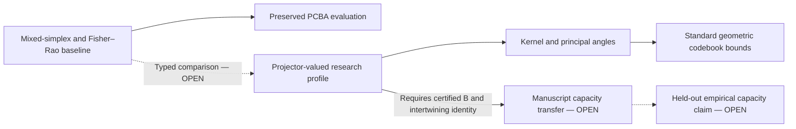

# Noetic Projection Geometry and State Capacity

Publication delta: `v0.1`

Control status: `DRAFT / OPEN / RING 4 / NOT LICENSED / HELD / NOT FROZEN`

Charter track: Paper 3 of the Project Coherence publication architecture

Source baseline: Git commit `a1cd990109e7561dfd03949bf0e1653461c7ae44`

## Abstract

This paper-shaped delta separates a standard, defensible geometry of finite-rank
orthogonal projectors from two presently unsupported conclusions: that model
states actually instantiate the proposed subspaces and that a new moving-
projector capacity theorem transfers to CAS.  It preserves the current CAS PCBA
mixed-simplex/Fisher--Rao address as the engineering baseline and treats a
projector-valued profile as an optional, typed Ring-4 research representation.

For common-rank orthogonal projectors \(P_x\) on one finite-dimensional Hilbert
space, the normalized overlap

\[
k(x,y)=\operatorname{tr}(P_xP_y)/d
\]

is a positive-semidefinite Hilbert--Schmidt Gram kernel in \([0,1]\).  Principal
angles give \(\operatorname{tr}(P_xP_y)=\sum_r\cos^2\theta_r\), and chordal
distance satisfies \(d_c^2=d-\operatorname{tr}(P_xP_y)\).  We also give a
direct centered-projector simplex bound: for \(N\) rank-\(d\) projectors in
ambient dimension \(D\), some pair obeys

\[
k(i,j)\geq\frac{dN-D}{D(N-1)}.
\]

This yields a standard geometric codebook envelope when the right-hand side is
positive.  It is not the stronger projection-capacity claim in the supplied
OpenAI manuscript.  That manuscript claim additionally requires an isometry
\(B:V\to W\otimes V\) satisfying a pointwise adjoint-intertwining identity on
every projector image.  No CAS-specific construction or verified certificate
currently supplies that condition, and a two-codeword example refutes the
weakened rank-and-coherence-only transfer.  Latent-state validity, stability,
specificity, predictive capacity, and all experimental comparisons therefore
remain explicitly unfinished.

## 1. Authority and nonreplacement boundary

This delta does not recreate the Noetic Topos, CAS PCBA, CAS Core, or a TKS v8
geometry specification.  Its exact source inputs are inventoried in
`SOURCE_INVENTORY_v0.1.json`.  The controlling distinctions are:

- the registered open 39-simplex \(\Delta_{39}^{\circ}\) and Fisher--Rao metric
  remain the conservative Noetic/PCBA geometric baseline;
- the PCBA address is a mixed probability-simplex point, not “one basis vector
  per state”;
- a projector-valued state profile \(P_x\) is a frontier model and must not be
  called a canonical PCBA address or validated hidden-state representation;
- the supplied *Ten Advances in Mathematics and Theoretical Computer Science*
  is an exact, hash-bound, public OpenAI technical manuscript without a DOI,
  named chapter authors, venue, or independent peer-review receipt; and
- every bespoke CAS transfer remains `OPEN / NOT LICENSED / HELD / Ring 4`.

Standard projector geometry can be proved and cited independently of that
manuscript.  Doing so does not validate the interpretation of any measured
activation as a cognitive state, and it does not discharge the manuscript's
additional capacity hypotheses.

**Figure 1.** The standard geometry lane does not replace the PCBA baseline and
does not enter the manuscript or empirical lanes without additional proof and
evidence.

## 2. Two type-distinct state representations

### 2.1 Mixed-simplex baseline

The existing baseline uses

\[
p=(p_1,\ldots,p_{40})\in\Delta_{39}^{\circ},\qquad
p_a>0,\quad \sum_a p_a=1,
\]

with tangent vectors summing to zero and Fisher--Rao form

\[
g_{\mathrm{FR},p}(u,v)=\sum_{a=1}^{40}\frac{u_av_a}{p_a}.
\]

This profile represents mixed composition over the registered coordinates.
Pure one-hot labels alone are insufficient for the intended PCBA geometry and
lie on the boundary rather than in the open smooth target.  Nothing in this
paper replaces that address or identifies its coordinates with projector
dimensions.

### 2.2 Projector-valued research profile

Let \(\mathbb F\in\{\mathbb R,\mathbb C\}\), let
\(H\cong\mathbb F^D\), and choose an integer \(1\leq d\leq D\).  A
rank-\(d\) projector profile assigns to each state label \(x\) an operator

\[
P_x=P_x^*=P_x^2,\qquad \operatorname{tr}P_x=d.
\]

Equivalently, \(P_x\) represents a point of the Grassmannian
\(\mathrm{Gr}_{\mathbb F}(d,D)\).  The profile must bind the ambient space,
basis convention, rank, layer/tensor identity, estimator, data split, numerical
dtype, tolerance, and source/model identities.  Two projectors produced in
different ambient spaces cannot be compared by trace until a reviewed typed
transport places them in one space.

There is presently no canonical map

\[
\Delta_{39}^{\circ}\longleftrightarrow
\mathrm{Gr}_{\mathbb F}(d,D).
\]

A future comparison may define a feature map, probabilistic mixture of
subspaces, or product representation, but it must state its loss and cannot be
called an identity without a theorem.

## 3. The normalized projector kernel

### 3.1 Definition and positive semidefiniteness

For common-rank projectors in one Hilbert space define

\[
k(x,y)=\frac{1}{d}\operatorname{tr}(P_xP_y)
=\left\langle\frac{P_x}{\sqrt d},
\frac{P_y}{\sqrt d}\right\rangle_{\mathrm{HS}}.
\]

For real coefficients \(c_x\), or complex coefficients with conjugation,

\[
\sum_{x,y}\overline{c_x}c_y k(x,y)
=\frac1d\left\|\sum_x c_xP_x\right\|_{\mathrm{HS}}^2\geq0.
\]

Thus \(k\) is positive semidefinite.  Since

\[
\operatorname{tr}(P_xP_y)
=\operatorname{tr}(P_xP_yP_x)
=\|P_yP_x\|_{\mathrm{HS}}^2,
\]

we have \(0\leq k(x,y)\leq1\) and \(k(x,x)=1\).  At common rank,
\(k(x,y)=1\) exactly when the two subspaces agree, while \(k(x,y)=0\) when
they are orthogonal.

The kernel need not be strictly positive definite: duplicate projectors or any
linear dependence among their Hilbert--Schmidt feature vectors makes the Gram
matrix singular.  Positive semidefiniteness is a standard construction, not an
empirical representation theorem.

### 3.2 Principal angles and chordal distance

Let \(0\leq\theta_1\leq\cdots\leq\theta_d\leq\pi/2\) be the principal
angles between the projector images.  Standard singular-value geometry gives

\[
\operatorname{tr}(P_xP_y)=\sum_{r=1}^d\cos^2\theta_r,
\]

so

\[
k(x,y)=\frac1d\sum_{r=1}^d\cos^2\theta_r,
\qquad
d_c^2(x,y)=d-\operatorname{tr}(P_xP_y)
=\sum_{r=1}^d\sin^2\theta_r.
\]

The normalized chordal square is \(d_c^2/d=1-k\).  Principal angles retain a
full \(d\)-component comparison; the scalar kernel averages their squared
cosines and therefore loses information.  The paper must not infer identical
geodesic, spectral, or task behavior from an equal scalar overlap.

## 4. A standard finite codebook envelope

### 4.1 Centered-projector simplex bound

The projector kernel itself supplies one safe state-capacity statement.  Center
each projector in the real Hilbert space of self-adjoint matrices:

\[
Q_i=P_i-\frac dD I.
\]

Then

\[
\|Q_i\|_{\mathrm{HS}}^2
=d-\frac{d^2}{D}=\frac{d(D-d)}D
\]

and, for \(i\neq j\),

\[
\langle Q_i,Q_j\rangle_{\mathrm{HS}}
=\operatorname{tr}(P_iP_j)-\frac{d^2}{D}.
\]

For \(N\geq2\), nonnegativity of \(\|\sum_iQ_i\|^2\) implies that at least
one unordered pair satisfies

\[
\langle Q_i,Q_j\rangle_{\mathrm{HS}}
\geq-\frac{\|Q_i\|_{\mathrm{HS}}^2}{N-1}.
\]

Substitution and division by \(d\) yield

\[
\boxed{\max_{i\neq j}k(i,j)
\geq\frac{dN-D}{D(N-1)}}.
\]

When a proposed codebook requires \(k(i,j)\leq\mu<d/D\), this necessary
condition rearranges to

\[
\boxed{N\leq\frac{D(1-\mu)}{d-D\mu}}.
\]

When \(\mu\geq d/D\), this rearrangement gives no finite upper bound.  The
bound is a standard Rankin/simplex-style specialization to centered projector
features.  It may be loose because not every point on the centered matrix
sphere is a projector.  It describes geometric codebook separation only; it
does not count psychologically meaningful states, hardware capacity, model
memory, or reliably recoverable latent concepts.

### 4.2 Feature-dimension Welch check

The uncentered normalized features \(P_i/\sqrt d\) are unit vectors in a real
inner-product space of dimension at most

\[
m_{\mathbb R}=D(D+1)/2
\quad\text{or}\quad
m_{\mathbb C}=D^2,
\]

depending on the scalar field.  The standard Welch bound therefore gives, for
\(N>m\),

\[
\max_{i\neq j} k(i,j)^2
\geq\frac{N-m}{m(N-1)}.
\]

This is a second necessary condition and a useful implementation check.  It is
not automatically sharper than the centered-projector bound, and neither bound
uses task labels or activation data.

## 5. The quarantined moving-projector capacity claim

The supplied OpenAI manuscript states a stronger projection bound.  Its exact
Proposition 4.1 assumes:

- a set \(X\) with unit vectors \(\ell_x\in W\) and
  \(t(x,y)=\langle\ell_x,\ell_y\rangle\);
- a \(D\)-dimensional Hilbert space \(V\);
- rank-\(d\) orthogonal projectors \(P_x\) on \(V\);
- an isometry \(B:V\to W\otimes V\); and
- for some \(\Lambda\geq0\), every \(x\), and every
  \(u\in\operatorname{im}P_x\), the identity

\[
B^*(\ell_x\otimes u)=\sqrt\Lambda\,u.
\]

If \(\Lambda>s\) and a code \(C\subseteq X\) has
\(t(x,y)\leq s\) at distinct code points, the manuscript claims

\[
|C|\leq \frac{1-s}{\Lambda-s}\frac{D}{d}.
\]

This is recorded as a `MANUSCRIPT_CLAIM`, not as independently established
literature or an admitted CAS theorem.  The internal source audit confirms that
the earlier CAS transfer omitted the displayed adjoint-intertwining condition.
Rank, projector overlap, and code coherence alone do not supply \(B\),
\(\Lambda\), or the identity.

### 5.1 Counterexample to the weakened transfer

Drop the intertwining requirement and retain only ranks and code coherence.
Take \(D=d=1\), two orthogonal unit vectors \(\ell_1,\ell_2\),
\(P_1=P_2=I\), \(s=0\), and substitute \(\Lambda=1\).  The weakened formula
would give \(|C|\leq1\), although the two codewords satisfy the stated
coherence threshold.  The missing structure is therefore load bearing.

No CAS-specific intertwiner, isometry check, code certificate, or independent
proof currently exists.  The stronger bound and every empirical conclusion
that depends on it remain `PROOF_GAP / OPEN`.

## 6. Estimation and stability requirements

A projector estimated from model activations is an empirical object, not merely
a matrix satisfying \(P^2=P\).  A defensible estimator record must bind:

- exact model, checkpoint, architecture, tokenizer, layer, tensor, and hook;
- prompt/dataset identity, rights, split, seeds, preprocessing, and controls;
- centering/whitening rule and the matrix whose subspace is estimated;
- rank-selection rule fixed without consulting held-out outcomes;
- numerical method, dtype, tolerance, and deterministic code identity;
- eigengap or singular-value-gap diagnostics;
- bootstrap or repeated-sample uncertainty for principal angles and overlaps;
- intervention, wrong-layer, wrong-axis, matched-taxonomy, and random-subspace
  controls; and
- an explicit failure state for rank instability or insufficient gap.

Davis--Kahan and Wedin perturbation theory can bound subspace rotation only
under the corresponding Hermitian or singular-subspace hypotheses and a
nonzero separation gap.  Quoting those theorems is not a stability measurement.
The exact perturbation, norm, gap, and target subspace must be recorded.

## 7. Experimental hypotheses remain unfinished

The shared claim ledger records the empirical hypothesis that learned projector
profiles identify CAS/TKS cognitive subspaces and predict held-out behavior.
No qualifying evidence packet exists.  A future preregistration must distinguish
at least the following hypotheses:

1. **Reliability:** repeated samples from a fixed condition produce stable
   subspaces within a declared principal-angle tolerance.
2. **Specificity:** matched in-concept examples overlap more than wrong-layer,
   wrong-axis, matched-taxonomy, and random-subspace controls.
3. **Incremental value:** projector features outperform or complement the
   preserved mixed-simplex/Fisher--Rao baseline on held-out outcomes.
4. **Causal sensitivity:** a preregistered intervention changes the target
   subspace more than negative controls while leaving named nuisance features
   within bounds.
5. **Capacity relevance:** any observed state count or error tradeoff is
   predicted by a fully certified geometric or moving-projector theorem rather
   than fitted after the fact.

Each hypothesis needs a target population, model family, estimand, controls,
uncertainty method, falsifier, multiplicity policy, held-out replication, and
independent execution/audit.  Until then, “latent cognitive subspace,” “state
capacity,” and “causal geometry” are research labels rather than findings.

## 8. Evidence and novelty partition

| Item | Evidence class | Novelty class | Current status |
|---|---|---|---|
| Normalized projector Gram kernel | Direct proof plus established Hilbert-space background | `STANDARD_SPECIALIZATION` | `DRAFT / OPEN` |
| Principal-angle and chordal identities | Established primary literature | `STANDARD_RESULT` | `DRAFT / OPEN` |
| Centered-projector simplex bound | Direct specialization of standard spherical/Grassmannian geometry | `STANDARD_SPECIALIZATION` | `DRAFT / OPEN / FORMALIZATION OPEN` |
| Welch feature-dimension check | Established primary literature | `STANDARD_SPECIALIZATION` | `DRAFT / OPEN` |
| Moving-projector Proposition 4.1 | Supplied unrefereed OpenAI technical manuscript | `MANUSCRIPT_CLAIM` | `PROOF_GAP / RING 4` |
| CAS-specific intertwiner | No construction | `FRAMEWORK_COUPLING` | `OPEN` |
| Projectors represent cognitive states | No admitted experiment | `EMPIRICAL_HYPOTHESIS` | `OPEN / NOT LICENSED / HELD` |
| Projector capacity predicts model behavior | No admitted experiment and theorem transfer open | `EMPIRICAL_HYPOTHESIS` | `OPEN / NOT LICENSED / HELD` |

The matrix in `THEOREM_AND_CLAIM_MATRIX_v0.1.json` gives the exact statement,
hypotheses, source IDs, evidence, counterexamples, and residual obligations.

## 9. Limitations and falsifiers

The formal geometry fails closed if projectors are not self-adjoint,
idempotent, common-rank, and placed in one typed ambient Hilbert space.  The
simplex bound must be withdrawn if its algebra, rank, or coherence convention
changes.  The manuscript transfer must be withdrawn unless a concrete \(B\)
is proved isometric and satisfies the adjoint identity for every certified
projector-image vector.

An empirical projector profile is falsified for its stated scope by any
preregistered condition such as:

- instability larger than the declared principal-angle threshold;
- control overlap equal to or larger than target overlap;
- no held-out improvement over the mixed-simplex baseline;
- rank or effect direction changing across seeds/checkpoints beyond tolerance;
- intervention and negative-control effects being indistinguishable; or
- inability to reproduce the exact projectors from retained source and
  environment identities.

Passing a mathematical identity cannot rescue a failed empirical hypothesis.
Passing an empirical comparison cannot fill a proof gap in the capacity
theorem.

## 10. Required completion work

Before this delta can become a submission candidate:

1. independently verify or reject the supplied moving-projector proposition and
   its proof against the exact manuscript bytes;
2. formalize the projector kernel, principal-angle identities, and centered
   simplex bound in the selected proof assistant;
3. construct a CAS-specific intertwiner or keep the stronger capacity theorem
   out of the CAS claim set;
4. define the typed comparison, if any, between mixed-simplex and projector
   profiles without replacing the baseline by assertion;
5. implement a numerically audited estimator and uncertainty pipeline;
6. preregister and run matched-control, held-out, multi-model experiments;
7. obtain independent operator-theory, coding-theory, numerical-linear-algebra,
   and experimental-methods review; and
8. complete authorship, disclosure, citation, and publication approval.

No experimental conclusion is represented as complete in this delta.  The
current mathematical drafting work requires no GPU run.

## References

The controlled citation record is `CITATION_LEDGER_v0.1.json`.  Primary
background includes Aronszajn on positive kernels
(<https://doi.org/10.1090/S0002-9947-1950-0051437-7>), Björck and Golub on
principal angles (<https://doi.org/10.1090/S0025-5718-1973-0348991-3>), Rankin
on spherical simplex/packing bounds
(<https://doi.org/10.1017/S2040618500033219>), Welch on coherence bounds
(<https://doi.org/10.1109/TIT.1974.1055219>), Conway--Hardin--Sloane on
Grassmannian packings
(<https://doi.org/10.1080/10586458.1996.10504585>), Davis--Kahan and Wedin on
subspace perturbation (<https://doi.org/10.1137/0707001>;
<https://doi.org/10.1007/BF01932678>), and Edelman--Arias--Smith on Grassmann
geometry (<https://doi.org/10.1137/S0895479895290954>).  The supplied OpenAI
manuscript is cited separately as an unrefereed technical manuscript at
<https://cdn.openai.com/pdf/ten-proofs-oai.pdf>.

Casazza--Kutyniok--Li
(<https://doi.org/10.1016/j.acha.2007.10.001>) is retained only as weighted
subspace-system background, and Bachoc--Vallentin
(<https://doi.org/10.1090/S0894-0347-07-00589-9>) only as established spherical
code/semidefinite-programming background.  Neither supplies the manuscript's
intertwiner or a CAS transfer.
